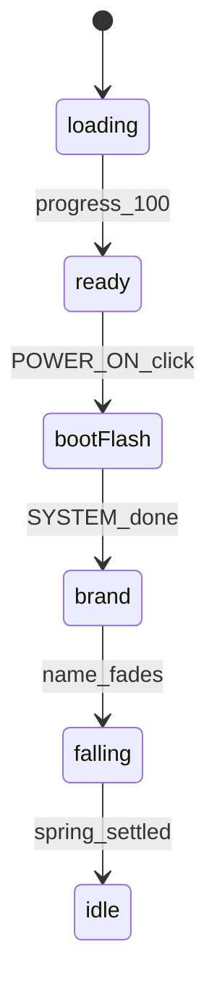

# Recreating the GameCube boot in my 3D portfolio

My portfolio already had a navigable 3D cube built with **React Three Fiber**. What was missing was the feeling of **turning on a console**: that moment when the screen goes dark, a jingle plays, a logo appears, and the cube falls into place with weight and character.

This note documents everything I built: the architecture, technical decisions, the problems I encountered while polishing the animation, and how I solved them.

> **Legal note:** The original GameCube jingle is property of Nintendo. I used an **original** four-note motif generated with the Web Audio API, which only plays after a user gesture (clicking POWER ON).

---

## Summary of what was implemented

| Piece | What it does |
|-------|----------|
| **Boot FSM** | State machine on the main page that orchestrates loading → POWER ON → cinematic → fall → idle |
| **SceneLoader** | 100% loader with **POWER ON** button; HTML SYSTEM beats and personal brand |
| **bootJingle.ts** | Ascending motif G4→B4→D5→G5 via oscillators |
| **GameCubeCube** | Spring fall, quaternion spin, and HOME-oriented landing |
| **globals.css** | Keyframes: POWER ON blink, SYSTEM flicker, brand fade, purple flash |

---

## Sequence Flow

The entire experience takes about **3–4 seconds** after clicking POWER ON:



1. **loading** — The `SceneLoader` shows progress 0→100% (geometry, shaders, R3F assets).
2. **ready** — The blinking **POWER ON** button appears. There is no auto-advance: the user decides when to boot.
3. **bootFlash** — Black screen, the jingle plays, **SYSTEM** flickers in HTML/CSS.
4. **brand** — **ENRIQUE VAZQUEZ** in Space Grotesk, wide tracking, ~500 ms and fade.
5. **falling** — The overlay disappears; the R3F cube falls from `y: 8`, spins, and lands with a bounce.
6. **idle** — The usual float/wobble; the hero, HUD, D-pad, and navigation are unlocked.

### Why POWER ON and not auto-play

Browsers block `AudioContext` without a user gesture. The **POWER ON** button solves that and also adds an interactive beat very much in console style: *"the system is ready, but you decide to turn it on"*.

---

## Architecture: who controls what

The state lives in `src/app/(portfolio)/page.tsx`:

```ts
type BootPhase =
  | "loading"
  | "ready"
  | "bootFlash"
  | "brand"
  | "falling"
  | "idle";
```

- **`SceneLoader`** — Loading UI, POWER ON button, and HTML cinematic beats.
- **`PortfolioCanvas` → `GameCubeCube`** — Fall physics and transition to idle.
- **`boot.ts`** — Shared type and `isBootPreFall()` helper.
- **`bootJingle.ts`** — Synthesized audio on click.

Interaction rules:

- `interactionEnabled = bootPhase === "idle" && !isModalOpen`
- Hero, HUD, decorative corners, and D-pad start appearing in **`falling`** (1s fade), but navigation only becomes active in **`idle`**.

---

## SceneLoader: from progress bar to boot ritual

Previously, upon reaching 100%, the loader would automatically fade out. Now:

- At 400 ms of `progress === 100`, `onReady()` is triggered → **ready** phase.
- The user sees **POWER ON** with the `boot-power-on-blink` animation.
- Upon clicking:
  - `playBootJingle()` is called (muted if `prefers-reduced-motion`).
  - `onPowerOn()` advances to **bootFlash**.
  - After ~550 ms → **brand**.
  - After ~800 ms (hold + fade out the name) → `onBrandComplete()` → **falling**.

Brand texts in CSS:

- **SYSTEM** — `boot-system-flicker` with `steps(2)` for hard flickering.
- **Enrique Vazquez** — `boot-brand-name` with `--font-space`, `boot-brand-in` / `boot-brand-fade-out`.
- Screen flash — `boot-screen-flash-active` with a purple radial gradient.

---

## Audio: original jingle with Web Audio

[`bootJingle.ts`](src/lib/bootJingle.ts) creates an `AudioContext` on user gesture and plays four triangle notes:

| Note | Frequency | Role |
|------|------------|-----|
| G4 | 392 Hz | Opening |
| B4 | 493.88 Hz | Rise |
| D5 | 587.33 Hz | Tension |
| G5 | 783.99 Hz | Resolution |

A sine pad in G3 (196 Hz) accompanies the last note. The tempo was adjusted several times to **sync with the cube fall** — it ended up being ~15% faster than the initial "slow" version.

---

## Cube fall in R3F (Option A)

The HTML cinematic ends; the real cube takes the spotlight. Final parameters (after tuning):

```ts
const FALL_START_Y = 8;
const SPRING_STIFFNESS = 17;
const SPRING_DAMPING = 6;
// initial velY: -4
// initial spin: 4.6 / 6.0 / 3.5 rad/s
```

### Physics

- **Spring** toward `y = 0` with dampened bounce.
- **Spin** accumulated with quaternion deltas (not loose Eulers), to avoid gimbal lock and weird snaps.
- **Orient pull** progressive: the lower the cube, the stronger the `slerp` toward `targetQuaternion` (HOME pose).
- **Impact flash**: purple `PointLight` + `emissiveIntensity` spike when crossing `y < 0.7`.

While `bootPhase` is `loading | ready | bootFlash | brand`, the cube remains at `y = FALL_START_Y` and **invisible**.

### Idle after landing

Upon completing the fall:

- `idleTimeRef` starts at `0` so the sine bob doesn't jump from a random `clock.elapsedTime` value.
- Wobble and mouse tilt resume with a smooth `slerp` toward the active view orientation.

---

## Polish iterations (what didn't go right the first time)

### 1. Snap at the end of the fall

**Problem:** as the spring settled, the code did `quaternion.slerp(targetQuaternion, 1)` — an instant snap — and at the same time the hero + HUD appeared.

**Solution:** internal `aligning` phase with an exponential slerp for ~1 s; UI visible from `falling` with a long fade; idle bob with local time.

### 2. Unnatural "redirection"

**Problem:** the cube fell spinning, landed crooked, and then "corrected" toward HOME in a separate movement.

**Solution:** remove the post-impact `aligning` phase and **blend orientation throughout the fall**. The `orientPull` grows with `smoothstep` based on height; the spin turns off as it approaches the floor. The cube arrives almost aligned without a visible corrective turn.

### 3. Fall too fast (no "GameCube vibe")

**Problem:** with `velY = -12` and `stiffness = 42`, everything was over in ~1 s. The tumble wasn't readable.

**Solution ("slow" tuning):**

| Parameter | Before | After |
|-----------|-------|---------|
| Initial `velY` | -12 | -2.5 |
| `SPRING_STIFFNESS` | 42 | 14 |
| Spin XYZ | 9.5 / 11 / 6.5 | 4.0 / 5.2 / 3.0 |
| Timeout | 2.8 s | 4.2 s |

### 4. A bit faster (final adjustment)

Feedback: *"much better, make it just a bit faster"*.

Adjustment ~15–20%:

- `velY: -4`, `stiffness: 17`, `damping: 6`
- Spin: 4.6 / 6.0 / 3.5
- Timeout: 3.5 s
- Jingle compressed in the same proportion

---

## Touched files

| File | Responsibility |
|---------|-----------------|
| [`src/lib/boot.ts`](src/lib/boot.ts) | `BootPhase` type and helpers |
| [`src/lib/bootJingle.ts`](src/lib/bootJingle.ts) | Web Audio motif |
| [`src/components/GameCube/SceneLoader.tsx`](src/components/GameCube/SceneLoader.tsx) | Loader + POWER ON + HTML beats |
| [`src/components/GameCube/GameCubeCube.tsx`](src/components/GameCube/GameCubeCube.tsx) | Fall, spin, flash, idle |
| [`src/components/GameCube/PortfolioCanvas.tsx`](src/components/GameCube/PortfolioCanvas.tsx) | Boot props to canvas |
| [`src/app/(portfolio)/page.tsx`](src/app/(portfolio)/page.tsx) | FSM, UI gating, and interaction |
| [`src/app/globals.css`](src/app/globals.css) | Boot keyframes |

No animation libraries (framer-motion, GSAP) were added. Everything is **CSS keyframes + R3F useFrame + Web Audio**.

---

## Accessibility

- `prefers-reduced-motion`: no flickering or spin; POWER ON is still required; shortened HTML sequence; muted audio; cube appears at HOME without dramatic fall.
- `aria-live` and labels in the loader according to the active phase.
- Navigation and D-pad with `tabIndex={-1}` until `idle`.

---

## Lessons learned

1. **Separate HTML beats from 3D physics** — Brand and SYSTEM live in an overlay; the R3F cube only enters on `falling`. That avoids fighting with z-index and pointer-events.

2. **The user gesture unlocks audio and rhythm** — POWER ON isn't just aesthetics; it's a technical and narrative requirement.

3. **Quaternions > Euler for tumble** — Accumulating spin with `quaternion.multiply(delta)` and continuously slerping toward HOME avoids the post-landing "redirect".

4. **Timing is 80% of the feel** — The same spring logic feels "cheap" or "GameCube" depending on stiffness, initial velocity, and when the orient pull starts. It's worth iterating on numbers, not architecture.

5. **Sync audio and movement** — Stretching or compressing the jingle when you change the fall duration makes the whole thing feel like a single beat.

---

## How to test it

1. Open the portfolio home.
2. Wait for the loader to reach 100%.
3. Press **POWER ON**.
4. Observe: SYSTEM → name → cube fall → hero and HUD appearing smoothly.

If you want to see just the physics, open DevTools and search for `bootPhase` in React DevTools while playing the sequence.

---

## Possible future improvements

- Save in `sessionStorage` that the boot was already seen and skip it on repeat visits (with a "reboot console" option in the HUD).
- Sync the impact flash with a bass **thump** in the jingle.
- Mobile variant with lower `FALL_START_Y` and reduced spin for small screens.
- Easter egg: hold POWER ON for an alternative boot.

---

*Written as part of the interactive portfolio development — Memory Card / Notes.*

